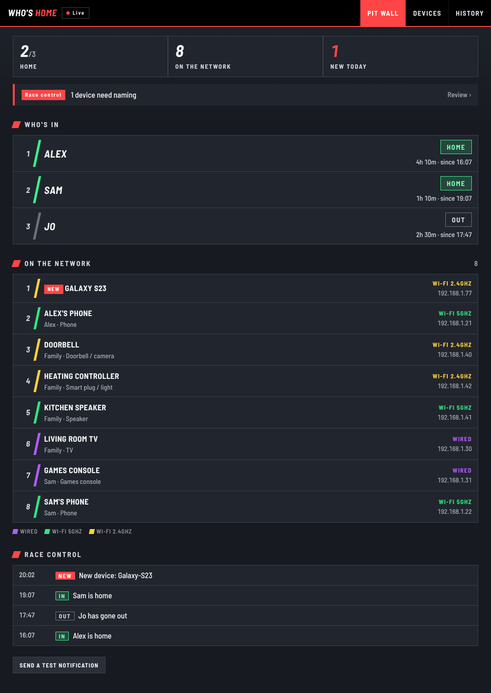

# Who's Home

A small home network watcher for a Raspberry Pi and a BT Smart Hub 2. It shows who in the family is in, gives every device on your Wi-Fi a proper name, and sends a notification to your phone when something new joins. It's styled like an F1 pit wall.

It runs on an old Pi too. It needs Python 3.5 or newer and nothing else installed, so a Raspberry Pi 2 still running an operating system from 2017 is fine.

## What it does

Every minute the Pi asks the BT Smart Hub 2 which devices are connected. The hub shares this with anything on your home network, so no router password is needed. From that it:

- shows who's home, based on whose phone is on the Wi-Fi, with a short wait so a phone napping to save battery doesn't count as someone going out
- lists every device with its connection, colour-coded like F1 sector times: purple for wired, green for 5GHz Wi-Fi and yellow for 2.4GHz
- sends a phone notification through the free [ntfy](https://ntfy.sh) app when a new device joins, and optionally when people come and go
- keeps a month of history and tidies older entries away by itself
- tucks devices that haven't been seen for two months into a "Gone quiet" list, and lets you ignore devices you don't care about

## How it names devices

The router's own names are often useless ("wlan0", a MAC address, "android-4f3a2b"), so Who's Home works a name out from several clues, all without leaving your home network:

- **The maker.** The first half of every device address is a maker's code. The official list of over 35,000 makers is included (`oui.tsv`), so it can say "Made by Sonos" without going online.
- **Asking the device.** Many devices announce their own name if you ask. Apple kit, Chromecasts and printers answer through Bonjour, TVs and consoles through UPnP, and Windows PCs through NetBIOS.
- **What it offers.** A few open ports give a device away. For example, every iPhone has one particular port open, even when it's hiding its maker.
- **Its web page title.** Printers and smart plugs often put their model there.
- **Educated guesses** that combine all of the above, like "Amazon Echo (Alexa)" or "Pantum printer".

Every device page has a "Use this name" button, so naming the rest is one tap each. There's also a report page you can copy and paste, which is handy for working out the stubborn ones.

Phones are the hardest. Modern phones use a made-up "private" address on each Wi-Fi network, and Android phones rarely announce themselves, so some will always need naming by hand.

## Setting it up

You'll need a Raspberry Pi on the same network as a BT Smart Hub 2, and a Windows PC with PowerShell to copy it across. The Pi needs to be reachable by `ssh`.

1. Install the free **ntfy** app on your phone and subscribe to a topic with a long, made-up name that nobody would guess. Anyone who knows the name can read your alerts.
2. Copy `config.example.py` to `config.py` and put your topic name in `NTFY_TOPIC`. Check that `WEB_PORT` isn't already used by something else on the Pi.
3. From this folder in PowerShell, run:

       powershell -ExecutionPolicy Bypass -File .\deploy.ps1 -Pi pi@raspberrypi.local

   Use whatever you normally type after `ssh` to reach your Pi. It copies everything over, sets it up as a service that starts on boot, and prints the address to open.

Run the same command again after any change.

On the first run it learns every device quietly, so you don't get an alert for each one. Then open the **Devices** page and work through "Still to name". For family phones, add the owner and tick "Counts for who's in".

## Handy commands on the Pi

    sudo systemctl status whoshome      # is it running?
    journalctl -u whoshome -f           # watch what it's doing
    cd ~/whos-home && python3 discover.py   # see which devices answer with a name

## Privacy

Your device list, names and history stay on the Pi, in `whoshome.db`, which isn't part of this repository. The only thing that leaves your house is the text of each notification, which goes through ntfy's server. You can run your own ntfy server if you want everything at home.

Before tracking who's in, tell the people you live with. Nobody enjoys finding out afterwards.

## Other projects worth a look

If you have a newer Pi or a home server that can run Docker, [NetAlertX](https://github.com/jokob-sk/NetAlertX) is far more capable and has a big community behind it. [WatchYourLAN](https://github.com/aceberg/WatchYourLAN) is a lighter option. Who's Home exists because neither would run on the old Pi I had, and because building it was fun.

## How it was built

I'm a business analyst, not a developer. I built this over two evenings by talking it through with Claude, mostly from my phone. I set out the problem and the constraints, tested it on my own network, and fed back what wasn't good enough. Claude wrote the code.

## Credits

- Maker list from the IEEE public registry, via the [netaddr](https://github.com/netaddr/netaddr) project.
- [Barlow Semi Condensed](https://github.com/jpt/barlow) font by Jeremy Tribby, under the SIL Open Font License (`fonts/OFL.txt`).
- Notifications by [ntfy](https://ntfy.sh).

## Licence

MIT. See `LICENSE`.
